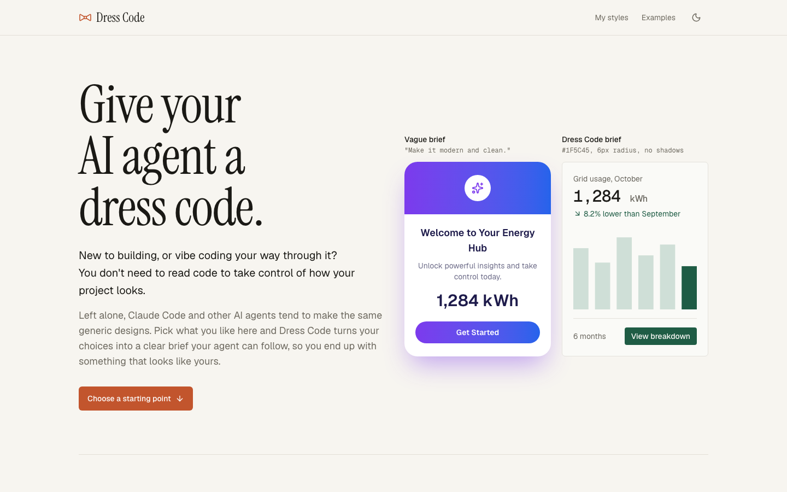

# Dress Code

**Give your AI agent a dress code.**

New to building, or vibe coding your way through it? You don't need to read code to take control of how your project looks. Pick what you like, and Dress Code turns your choices into a clear design brief for Claude Code or any AI coding agent, so you end up with something different from the usual AI-made look.

**Try it:** https://indiaclarke03-ops.github.io/DressCode/



Everything runs in your browser. Nothing you paste is uploaded, and there are no accounts.

## Three ways to use it

- **Start fresh:** about to build something new? Set the look first and get a `DESIGN.md`, `SKILL.md`, `CLAUDE.md` snippet, `tokens.css`, a Tailwind theme and a kickoff prompt.
- **Restyle existing:** have a working project you dislike the look of? Paste your styles or drop in a screenshot, and get a `RESTYLE.md` that changes how it looks without changing what it does.
- **Quick tweaks:** want one small change? Find one of 46 tweaks, adjust it, and copy a short, precise prompt. Add several to the basket to send them together.

## Saved styles

Save a style for a brand or company, then reuse it before anything you make. **My styles** gives you the `DESIGN.md`, or a prompt written for a website, web app, slide deck, graphic or document.

Styles live in your browser. To move one to another device or share it with a team, export it as a file and import it there.

## Local development

```sh
npm install
npm run dev        # http://localhost:5173/DressCode/
npm run test       # unit tests
npm run test:e2e   # Playwright checks, with screenshots in e2e/screenshots
npm run build
```

`base` defaults to `/DressCode/` for GitHub Pages. Set `VITE_BASE=/` to build for a custom domain.

To add a quick tweak, add an entry to a file in `src/tweaks/`. No UI changes are needed. The original build plan is in [SPEC.md](SPEC.md).

## Licence

[MIT](LICENSE)
